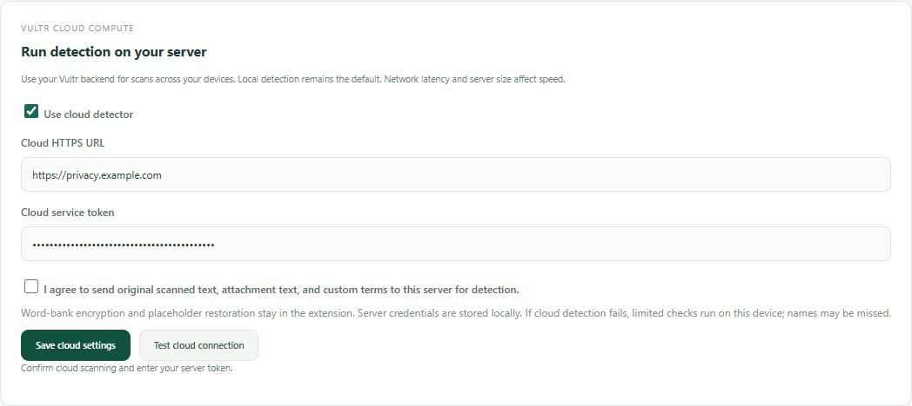
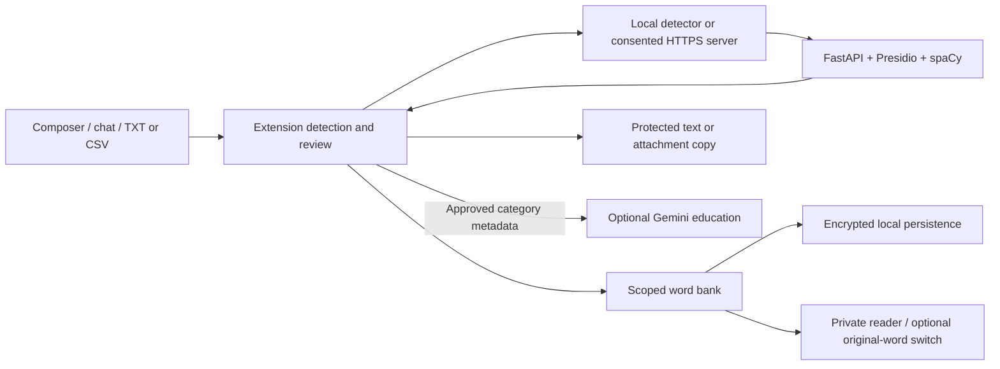

# Privruhty

### Share the idea. Protect the identity.

**An accessible privacy assistant for AI conversations.**

Privruhty helps you spot sensitive information, replace it with consistent placeholders, and read AI responses with familiar names again. It works alongside **ChatGPT, Claude, and Gemini** through a Chrome extension, with a private composer, protected attachments, and guided review.

Built with **TypeScript, React, FastAPI, Microsoft Presidio, spaCy, Web Crypto, Gemini API integration, and Vultr deployment support**.

[Quick start](#quick-start) | [Demo](#try-the-demo) | [Accessibility](#built-for-inclusive-review) | [Cloud integrations](#gemini-and-vultr) | [Security](docs/security.md)

## The problem

A useful AI prompt can also contain a colleague's name, a customer's email, a phone number, or a credential. Removing those details manually interrupts the task, and understanding what to remove can be difficult without clear explanations.

Privruhty brings detection, review, and reversible placeholders into the writing workflow. Users can protect a draft while preserving repeated references and decide what gets shared.

## How it works

1. **Write or attach.** Draft in Secure Composer, review a supported chat editor, or attach a TXT/CSV file.
2. **Detect and review.** See highlighted findings and proposed replacements. Use individual suggestions or the guided VoiceGuard experience.
3. **Protect.** Replace approved information with consistent placeholders such as `PERSON_1` and `EMAIL_1`. Attachment Auto-protect can hand the chat a checked copy automatically; review-first mode is also available.
4. **Read comfortably.** Use the private reader to restore known originals inside the extension, or explicitly enable the on-page original-word switch.

Privruhty never clicks the chat's **Send** button. Websites may upload attachments as soon as they are attached.

## What you can do

| Feature                  | Experience                                                                                                                                  |
| ------------------------ | ------------------------------------------------------------------------------------------------------------------------------------------- |
| Live privacy suggestions | Automatic scans, readable highlights, hover suggestions, and a movable review panel.                                                        |
| Secure Composer          | Draft in an extension-owned editor, review changes, approve, then separately confirm copying or insertion.                                  |
| Contextual detection     | Pattern checks cover structured identifiers and credentials; Presidio/spaCy adds names and contextual entities. Add custom protected terms. |
| Encrypted word bank      | Reuse consistent placeholders within a workspace, with optional passphrase-encrypted original mappings. Credentials are never restored.     |
| Original-word switch     | Toggle saved originals and placeholders in rendered conversations, including streaming responses.                                           |
| Private reader           | Read restored values in an extension page or side panel, outside the chat website's DOM.                                                    |
| Attachment protection    | Hold drops, file picks, and pasted files; scan supported text; attach protected copies with generic filenames. Source files stay unchanged. |
| Document tools           | Review and export TXT/CSV, or encrypt/decrypt files locally using passphrase-based AES-GCM.                                                 |
| VoiceGuard               | Review one finding at a time with keyboard controls, optional on-device voice commands, explanations, undo/redo, and explicit approval.     |

### Built for inclusive review

Privruhty's Coder for Good focus is helping more people understand and control privacy decisions. VoiceGuard offers simple explanations, one-item review, adjustable text, high contrast, visible keyboard focus, and screen-reader status announcements. Keyboard controls remain available when speech is unavailable.

Voice recognition requires supported on-device English recognition and a local language pack. It starts only after a user action and has no remote recognition fallback. Optional spoken output uses local voices. Human accessibility testing and real microphone validation remain future validation work; automated checks are not a WCAG certification.

## Gemini and Vultr

### Gemini: explain the privacy decision

The optional Gemini integration explains detected risks, replacement strategies, phishing concerns, and correctness tradeoffs. Requests contain only explicitly approved category/task/strategy/topic metadata. Original drafts, documents, mappings, audio, and transcripts are excluded from the explanation request. Structured responses are validated; local lessons remain available when Gemini is disabled or unavailable.

Configure backend-only `GEMINI_API_KEY` and `GEMINI_MODEL`, enable Gemini education in Settings, and approve metadata disclosure in the review. See [Gemini integration](docs/sponsors/gemini-api.md) and [configuration instructions](docs/voiceguard.md).

### Vultr: run the detector on your server

The included Vultr deployment runs the FastAPI detector behind Caddy HTTPS using Docker Compose. Two workers preload the detection model. Extension Settings provides a cloud endpoint, separate token, explicit consent, and a connection test with round-trip timing. Local detection remains the default.

Cloud scanning sends original scanned text and custom terms to your configured server. Word-bank encryption and restoration stay in the extension. See [deployment and connection instructions](docs/sponsors/vultr.md).



**Integration status:** Gemini code and Vultr deployment configuration are implemented. Live Gemini requests, a running Vultr deployment, and cloud speed improvements have not been verified. Credentials are supplied by the operator and are not bundled in this repository.

## Quick start

**Requirements:** Desktop Chrome, Node.js 22.20+ within the supported range in `extension/package.json`, npm, and Python 3.11 or 3.12. Gemini and Vultr accounts are optional for the local demo.

### 1. Clone and start the detector

Run in Windows PowerShell:

```powershell
git clone https://github.com/Abulala1/privruhty.git
Set-Location privruhty
py -3.11 -m venv backend/.venv
& ./backend/.venv/Scripts/python.exe -m pip install -r backend/requirements.txt
& ./backend/.venv/Scripts/python.exe -m spacy download en_core_web_sm
& ./backend/.venv/Scripts/python.exe -m uvicorn app.main:app --app-dir backend --host 127.0.0.1 --port 8765
```

Leave the terminal running. On first startup, the service creates `%USERPROFILE%/.pribruhty-token`. Copy that token into Privruhty Settings; keep it out of commits and recordings. The legacy token filename is retained for compatibility.

### 2. Build and load the extension

In a second terminal at the repository root:

```powershell
Set-Location extension
npm ci
npm run build
```

1. Open `chrome://extensions` and enable **Developer mode**.
2. Choose **Load unpacked** and select the repository's `extension/dist` folder.
3. Open Privruhty **Settings**, save the local service token, and select **Test connection**.
4. Refresh existing chat tabs. Repeat this after rebuilding or reloading the extension.

Without a connected detector, limited on-device checks still cover common structured identifiers; contextual names may be missed.

## Try the demo

Use only synthetic information during the demo.

### Protect a draft and restore familiar words

1. Open **Composer** and enter: `Write an email to Alice Tan at alice@example.com.`
2. Wait for suggestions, review the findings, and approve the changes. Name detection requires the configured contextual detector.
3. Choose **Approve Draft**, then separately confirm copy or insertion into a supported chat. Send the message yourself after checking it.
4. Open **Private reader beside chat** to view saved originals inside the extension. Alternatively, explicitly choose **Show originals** on the page and switch back with **Show placeholders**.
5. Try the guided VoiceGuard review with keyboard controls and its explanation options.

Mappings belong to a chat path, document, or private composer workspace. Select the matching workspace if a new chat URL changes after submission. Save the word bank with a passphrase if you want encrypted persistence; worker restarts lock saved banks, temporary mappings can be lost, and sessions expire after eight hours.

### Protect an attachment

1. Use [attachment-test.txt](test-data/attachment-test.txt), which contains fictional information.
2. Drop it into a supported chat. Privruhty holds the original event while checking the file.
3. Inspect the attached `protected-document-1.txt`: the test email should become `EMAIL_1`, and the phone should become `PHONE_1` in a fresh workspace. Existing mappings can change the numeric suffix.
4. Choose **Settings > Attachment handling > Review before attaching** to require approval before hand-off.

Automatic replacement supports **UTF-8 TXT/CSV, up to 1 MB per file and five files per batch**. Unsupported formats, unsafe scan results, and failed scans stay held. If a website rejects scripted attachment, download the checked copies and attach them manually. Live website behavior may vary.

The Documents page also supports local encryption/decryption of any file format up to **10 MB**. Encrypted files are for private storage or transfer; ordinary AI tools cannot read them. PDF, DOCX, and image text replacement is not implemented.

## Architecture



| Directory       | Contents                                                                                   |
| --------------- | ------------------------------------------------------------------------------------------ |
| `extension/`    | Chrome Manifest V3, React/TypeScript UI, VoiceGuard, word bank, attachment guard, tests    |
| `backend/`      | FastAPI detector, Presidio/spaCy integration, Gemini education endpoint, tests, Dockerfile |
| `deploy/vultr/` | Docker Compose, HTTPS proxy, and environment configuration template                        |
| `test-data/`    | Clearly labelled synthetic demo files                                                      |
| `docs/`         | Architecture, security boundaries, research, and integration guides                        |

## Verification

The current version passes **32 extension unit tests, 12 backend tests, and 13 Chromium integration tests**. The browser suite loads the real extension with isolated synthetic chat pages and checks outgoing attachment bytes, protected text, encryption, review controls, streaming restoration, and extension reload behavior. Speech/provider responses are simulated in labelled tests.

GitHub Actions runs formatting, linting, tests, and the extension build. See [CONTRIBUTING.md](CONTRIBUTING.md) for commands. Live chat layouts, live cloud services, real microphone accuracy, and human screen-reader experience require separate verification.

## Privacy boundaries

- Sites can observe text typed in their own editors. Use **Secure Composer** for confidential drafts.
- **Show originals on the page exposes restored values to that website.** Use the extension-owned private reader for stronger separation.
- Detection can miss information, and context can identify someone even after replacement. Replacing exact numbers can also change calculations.
- Attachment interception is a best-effort browser event guard, not a system-wide data-loss prevention boundary.
- Lost passphrases and expired or deleted mappings cannot be recovered. Local malware, compromised browser profiles, screenshots, and clipboard exposure are outside this tool's protection.

Read the [security model](docs/security.md) before using real confidential information.

## Project notes

Privruhty combines practical privacy controls with explanations that help users understand their choices. Next steps include broader document support, live-site compatibility testing, human accessibility testing, and measured cloud performance.

[Architecture](docs/architecture.md) | [Project description](docs/devpost.md) | [Coder for Good](docs/sponsors/coder-for-good.md) | [Gemini API](docs/sponsors/gemini-api.md) | [Vultr](docs/sponsors/vultr.md) | [Related work](docs/similar-projects.md)
