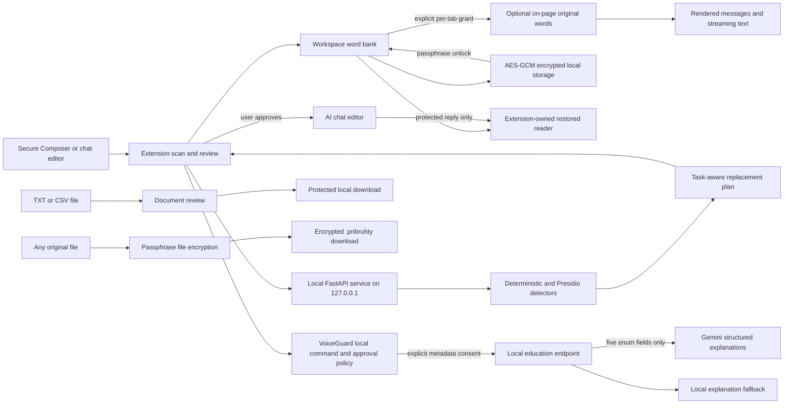

# Architecture

The document-start attachment guard holds original file events, obtains current tab scope and bank session, transforms supported TXT/CSV using shared scans and export, then rechecks settings/session/scope before handing off new Files. Cancellation, navigation, locked banks, and unsafe results stop hand-off. Download is the fallback when scripted attachment is rejected.

VoiceGuard reuses the existing scan/mapping pipeline and selected spans in Composer, document review, and inline review. `voiceguard.ts` holds command/metadata policy, lessons, and bounded in-memory action history; `speech.ts` enforces local-only recognition/output. `VoiceGuardReview.tsx` presents accessible review and explicit approval. The service worker forwards only consented enum metadata to `/explain`; the FastAPI backend calls Gemini and validates its structured response. Originals never enter the education API. See [VoiceGuard setup](voiceguard.md).

No prompt or document content is sent to a hosted model by Privruhty itself. Approved insertion puts protected text in the host editor, which the user may then send. Detection runs through the service worker so it can allocate stable per-workspace mappings under a serialized mutation queue. The worker holds unlocked bank keys in memory and writes only authenticated ciphertext to local storage. Extension pages alone can unlock and read the full word bank. Content scripts request detection, and optional on-page restoration additionally requires a per-tab/conversation grant enabled through the popup or on-page switch.

The private reader is an extension page, also accessible in Chrome's side panel. It reads protected replies on user request and renders familiar originals without changing host-page content. A separate opt-in page mode uses a mutation observer to restore complete known tokens in rendered messages automatically. The page can read originals in that mode; it is explicitly not an isolation boundary. Editable drafts are excluded, and locking the bank revokes page grants and reverts tracked text. CSV parsing/export verification uses Papa Parse. Whole-file encryption operates on original bytes and is separate from replacement export.
